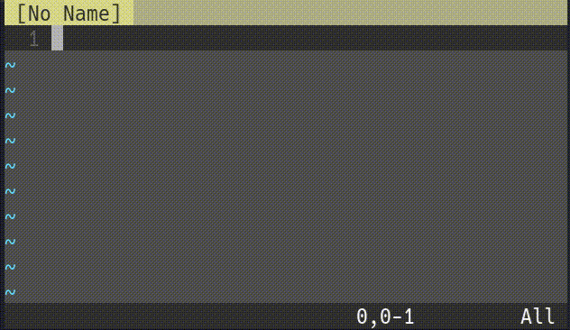
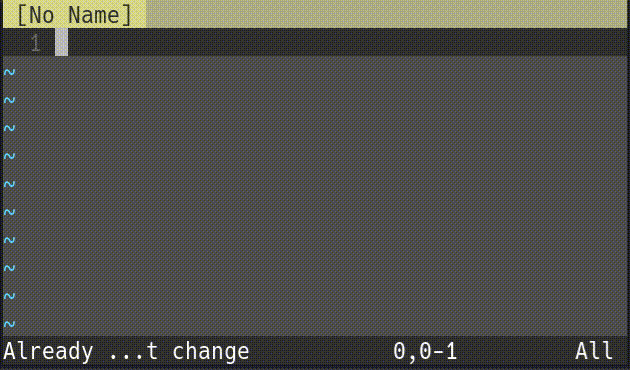
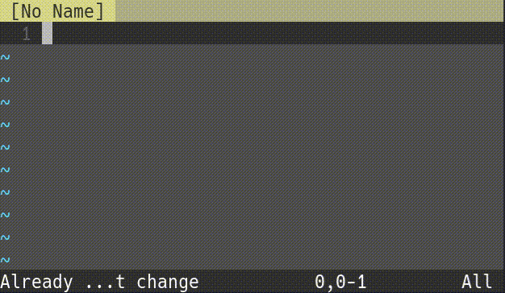
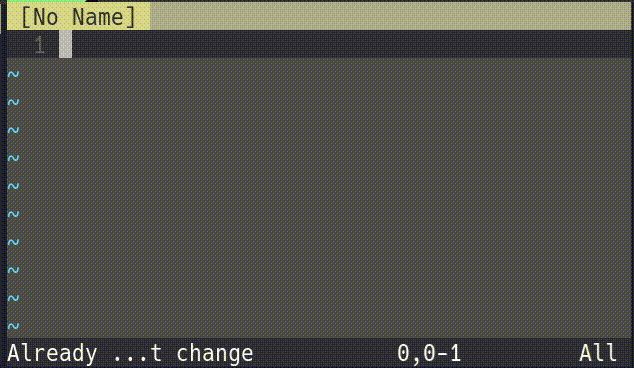

# Caskk

[](https://github.com/NI57721/vim-caskk/actions/workflows/ci.yml)

[日本語](README.md)

I wanted an IME that would let me get the conversion I intended even without looking at the screen.  
That's why I started building Caskk 🍺


Caskk is an SKK-style Japanese input plugin for Vim. It uses SKK dictionaries for conversion, with optional support for verb and adjective conjugations. Its input schemes are easy to customize for AZIK users.


## Demo
  


Keep specific words at the top or bottom of the candidate list.
  


Convert verbs and adjectives by combining a stem with an inflected ending.
  


You can also register verbs and adjectives directly from the input field.
  


## Prerequisite

CI tests Vim `9.1.1826` and Vim `HEAD`.  
Install Caskk on Vim's `runtimepath` and use the [example configuration](#example) to get started.


### Example

This example extends standard romaji input and assigns `<C-J>` to toggle the IME.

```vim
vim9script

import autoload 'caskk.vim' as Caskk

# Add special sequences to standard romaji input
Caskk.RegisterInputScheme({
  base: 'roman',
  name: 'roman',
  specials: {
    'z-': '〜',
    'z=': '＝',
    'z ': '　',
    'z/': '・',
    'z[': '『',
    'z]': '』',
  }
})

Caskk.Config({
  dictionaries: [
    {path: '/path/to/SKK-JISYO.verb-adjective', encoding: 'utf-8'},
    {path: '/path/to/SKK-JISYO.L',              encoding: 'euc-jp'},
  ],
  state_path: expand('$XDG_STATE_HOME/caskk/state.jsonl'),
  candidate_select_keys: ['1', '2', '3', '4'],
  sticky_key: ';',
  affix_key: ';;',
  mappings: {
    "\<Space>": 'NextCandidate',
    "\<C-N>":   'NextCandidate',
    "\<C-P>":   'PreviousCandidate',
    "\<C-M>":   'Commit',
    '/':        'AbbreviationMode',
    "'":        'KatakanaMode',
    '#':        'HalfwidthKatakanaMode',
    '@':        'FullwidthAlphanumericMode',
    'p':        'TogglePin',
    'P':        'ToggleDemote',
    "\<C-H>":   'DeleteUserEntry',
    "\<Tab>":   'NextCompletion',
    "\<S-Tab>": 'PreviousCompletion',
    "\<C-E>":   'CancelCompletion',
  },
  highlight: {
    preedit: {
      term: 'reverse,bold', cterm: 'reverse,bold', gui: 'reverse,bold',
    }
  },
})

# Toggle the IME
inoremap <silent> <C-J> <ScriptCmd>Caskk.Toggle('roman')<CR>
cnoremap <silent> <C-J> <ScriptCmd>Caskk.Toggle('roman')<CR>

# Reconvert
nnoremap <Leader>r <ScriptCmd>Caskk.Reconvert()<CR>
```

<details>
<summary>Legacy Vim script configuration</summary>

```vim
" Add special sequences to standard romaji input
call caskk#RegisterInputScheme(#{
      \   base: 'roman',
      \   name: 'roman',
      \   specials: {
      \     'z-': '〜',
      \     'z=': '＝',
      \     'z ': '　',
      \     'z/': '・',
      \     'z[': '『',
      \     'z]': '』',
      \   }
      \ })

call caskk#Config(#{
      \   dictionaries: [
      \     #{path: '/path/to/SKK-JISYO.verb-adjective', encoding: 'utf-8'},
      \     #{path: '/path/to/SKK-JISYO.L',              encoding: 'euc-jp'},
      \   ],
      \   state_path: expand('$XDG_STATE_HOME/caskk/state.jsonl'),
      \   candidate_select_keys: ['1', '2', '3', '4'],
      \   sticky_key: ';',
      \   affix_key: ';;',
      \   mappings: {
      \     "\<Space>": 'NextCandidate',
      \     "\<C-N>":   'NextCandidate',
      \     "\<C-P>":   'PreviousCandidate',
      \     "\<C-M>":   'Commit',
      \     '/':        'AbbreviationMode',
      \     "'":        'KatakanaMode',
      \     '#':        'HalfwidthKatakanaMode',
      \     '@':        'FullwidthAlphanumericMode',
      \     'p':        'TogglePin',
      \     'P':        'ToggleDemote',
      \     "\<C-H>":   'DeleteUserEntry',
      \     "\<Tab>":   'NextCompletion',
      \     "\<S-Tab>": 'PreviousCompletion',
      \     "\<C-E>":   'CancelCompletion',
      \   },
      \   highlight: #{
      \     preedit: #{
      \       term: 'reverse,bold', cterm: 'reverse,bold', gui: 'reverse,bold',
      \     }
      \   },
      \ })

" Toggle the IME
inoremap <silent> <C-J> <Cmd>call caskk#Toggle('roman')<CR>
cnoremap <silent> <C-J> <Cmd>call caskk#Toggle('roman')<CR>

" Reconvert
nnoremap <Leader>r <Cmd>call caskk#Reconvert()<CR>
```
</details>


# Interface

## Hooks

Caskk provides these `User` autocommands.  
For example, use the following command to observe when preedit starts.  
`autocmd User CaskkPreeditStart echo "Preedit started"`


### `CaskkEnable`

Fires when Caskk is enabled in the affected buffer.


### `CaskkDisable`

Fires when Caskk is disabled in the affected buffer.


### `CaskkInputModeChanged`

Fires when the input mode changes, for example from hiragana to katakana.


### `CaskkPreeditStart`

Fires when editing a reading for conversion begins.


### `CaskkPreeditEnd`

Fires when preedit ends through completion or cancellation of the conversion.


### `CaskkConversionStart`

Fires when the first conversion candidate is previewed.


### `CaskkConversionEnd`

Fires when candidate selection ends through commit, cancellation, or exhaustion.


### `CaskkCompletionStart`

Fires when the reading completion list opens.


### `CaskkCompletionEnd`

Fires when the reading completion list closes.


### `CaskkRegistrationStart`

Fires when the dictionary registration field opens.


### `CaskkRegistrationEnd`

Fires when registration is completed or cancelled and the result is applied at the original input position.


## APIs

Caskk provides APIs for input and reconversion.  
In legacy Vim script, call the functions as follows.

```vim
call caskk#Enable('roman')
```

In Vim9 script, import the module first.

```vim
vim9script
import autoload 'caskk.vim' as Caskk

Caskk.Enable('roman')
```

### `Caskk.Config(options)`

Configures Caskk and loads system dictionaries.  
See [Configuration](#configuration) for details.


### `Caskk.RegisterInputScheme(definition)`

Registers or updates a named input scheme.  
See [Defining an input scheme](#caskkregisterinputschemedefinition) for details.


### `Caskk.Enable(name)`

Enables Caskk input in the current buffer or supported command line.


### `Caskk.Disable()`

Disables Caskk input and restores the previous mappings.


### `Caskk.Toggle(name)`

Toggles Caskk input.


### `Caskk.IsEnabled()` → `bool`

Reports whether Caskk input is enabled.


### `Caskk.Reconvert()` → `bool`

In Normal mode, reopens a recent conversion whose text overlaps the cursor. Returns `true` when reconversion starts.


### `Caskk.LoadState()`

Loads user entries, learned history, and ranking preferences from `state_path`.


### `Caskk.SaveState()`

Saves the current user state to `state_path`.


### `Caskk.ExportUserDictionary(path)`

Exports registered user entries as a UTF-8 SKK dictionary.


### `Caskk.GetInputScheme(name)` → `CompiledScheme`

Returns the compiled form of a registered input scheme.


### `Caskk.GetDictionaryLoadStatus()` → `dict<string>`

Returns dictionary loading status (`loading`, `ready`, or `error`) and error details.


### `Caskk.OpenRegistration()`

Opens the dictionary registration UI for the pending word.


### `Caskk.CompleteRegistration(text [, annotations])`

Completes dictionary registration with a candidate body and optional annotations.


### `Caskk.CancelRegistration()`

Cancels the pending registration.


### `Caskk.GetRegistrationRequest()` → `Request` or `null_object`

Returns information about the pending registration.


## Configuration

`Caskk.Config(options)` takes a dictionary of options, for example `Caskk.Config({sticky_key: ";", mode_popup: false})`. Each call resets omitted options to their defaults.  
All keys are optional, as indicated by `?` below.

```text
options: {
  sticky_key?: string,
  affix_key?: string,
  keyboard_layout?: 'US' | 'JIS',
  keyboard_layout_overrides?: dict<string>,
  mappings?: dict<string>,
  dictionaries?: list<{path: string, encoding: string}>,
  state_path?: string,
  small_tsu_okuri_as_t?: bool,
  prefer_direct_okuri_nashi_learning?: bool,
  keep_preedit_on_backspace?: bool,
  undo_revert_to_reading?: bool,
  persist_input_mode?: bool,
  registration_auto?: bool,
  registration_prefill?: bool,
  registration_inline?: bool,
  register_mode_conversions?: bool,
  completion_min_length?: number,
  candidate_popup?: bool,
  candidate_select_keys?: list<string>,
  mode_popup?: bool,
  mode_popup_labels?: dict<string>,
  mode_popup_markers?: dict<string>,
  mode_popup_time?: number,
  highlight?: {preedit?: dict<string>},
}
```

### `sticky_key`

Type **string**, default `''`  
Treats the following key as modified input, like uppercase input in SKK.


### `affix_key`

Type **string**, default `''`  
Assigns a key sequence for entering `>` in prefix and suffix lookups.  
With `{sticky_key: ';', affix_key: ';;'}`, type `;;てき` to look up `>てき` or `;hi;;` to look up `ひ>`.


### `keyboard_layout`

Type **string**, default `'US'`  
Selects the keyboard layout. The accepted values are `US` and `JIS`.


### `keyboard_layout_overrides`

Type **dictionary**, default `{}`  
Overrides individual unshifted-to-shifted symbol mappings.  
For example, `keyboard_layout_overrides: {'1': '?'}` makes `?` the shifted form of `1`. If `1` maps to the consonant `k`, typing `?a` is equivalent to typing `Ka`.


### `mappings`

Type **dictionary**, default `{}`  
Assigns keys to input mode changes and conversion operations. See [Mapping Actions](#mapping-actions).


### `dictionaries`

Type **list**, default `[]`  
Lists SKK dictionaries in priority order. Each entry requires `path` and `encoding`.

```vim
dictionaries: [
  {path: '/path/to/SKK-JISYO.utf8', encoding: 'utf-8'},
  {path: '/path/to/SKK-JISYO.L',    encoding: 'euc-jp'},
],
```


### `state_path`

Type **string**, default `''`  
Sets the user state file. Caskk loads it on first enable and saves changes automatically, including on Vim exit. An empty path keeps state in memory.


### `small_tsu_okuri_as_t`

Type **boolean**, default `true`  
Uses `t` as the SKK lookup consonant for okuri beginning with っ. For example, a lookup for `おも*っ` uses the t-row key.


### `prefer_direct_okuri_nashi_learning`

Type **boolean**, default `true`  
Ranks direct selections without okuri ahead of learned selections for the same stem with okuri.  
If you convert `いえ` to 家 and then `いえ*る` to 癒える, 家 still ranks ahead of 癒え for `いえ`. Selecting 癒え directly for `いえ` then moves it ahead of 家.


### `keep_preedit_on_backspace`

Type **boolean**, default `true`  
Keeps preedit active when Backspace deletes the last reading character.


### `undo_revert_to_reading`

Type **boolean**, default `true`  
Adds an undo step that restores the reading before removing it.


### `persist_input_mode`

Type **boolean**, default `false`  
Keeps the input mode when leaving and re-entering Insert mode in the same buffer.


### `registration_auto`

Type **boolean**, default `true`  
Automatically opens dictionary registration when conversion candidates run out.


### `registration_prefill`

Type **boolean**, default `true`  
Prefills the registration field with the reading.


### `registration_inline`

Type **boolean**, default `true`  
Uses an inline popup for registration. Set this to `false` to use a separate registration window.


### `register_mode_conversions`

Type **boolean**, default `true`  
Registers the results of katakana and fullwidth alphanumeric conversions in the user dictionary.


### `completion_min_length`

Type **positive integer**, default `2`  
Sets the minimum reading length for completion.


### `candidate_popup`

Type **boolean**, default `true`  
Shows conversion candidates in a popup.


### `candidate_select_keys`

Type **list**, default `[]`  
Assigns label keys for choosing conversion candidates.  
By default, you move through candidates one at a time.  
With `['1', '2', '3']`, each page shows up to three candidates. Use `1`, `2`, or `3` to select one.


### `mode_popup`

Type **boolean**, default `true`  
Shows the current input mode in a popup near the cursor.


### `mode_popup_labels`

Type **dictionary**, default `{hiragana: 'あ', abbreviation: 'ab', katakana: 'ア', halfwidth_katakana: 'ｱ', fullwidth_alphanumeric: 'Ａ'}`  
Sets the labels for the input modes shown in the popup.


### `mode_popup_markers`

Type **dictionary**, default `{modified: '▽', candidate: '▼'}`  
Sets the popup markers for editing a reading and selecting a conversion candidate.


### `mode_popup_time`

Type **nonnegative integer**, default `0`  
Sets how many milliseconds the mode popup stays visible. With `0`, it stays visible until the cursor moves or input ends.


### `highlight` (`preedit`)

Type **dictionary**, default `{preedit: {term: 'underline', cterm: 'underline', gui: 'underline'}}`  
Sets highlighting for preedit text.


## Mapping Actions

The `mappings` dictionary maps keys to action names. For example, `mappings: {"\<Space>": "NextCandidate"}` assigns Space to start conversion or advance to the next candidate. Use Vim keycodes such as `"\<Space>"` for special keys.


### `NextCandidate`

Starts conversion or advances to the next candidate.


### `PreviousCandidate`

Moves to the previous candidate. Moving back from the first candidate restores the editable reading.


### `Commit`

Commits the conversion.


### `NextCompletion`

Opens the completion popup and selects the first item, or advances to the next suggestion.


### `PreviousCompletion`

Moves to the previous reading suggestion. Moving back from the first item clears the selection. Moving back with no selection selects the last item.


### `CancelCompletion`

Closes completion and restores the editable reading.


### `OpenRegistration`

Opens dictionary registration for the pending word.


### `TogglePin`

Toggles pinning for the selected candidate. Pinned candidates rank first.  
Each reading can have one pinned candidate.


### `ToggleDemote`

Toggles demotion for the selected candidate. Demoted candidates rank last.  
Each reading can have multiple demoted candidates.


### `DeleteUserEntry`

Opens a confirmation prompt to delete the selected user entry.


### `AbbreviationMode`

Switches to abbreviation mode, where typed text is used directly as the dictionary reading.


### `KatakanaMode`

Switches to fullwidth katakana input.


### `HalfwidthKatakanaMode`

Switches to halfwidth katakana input.


### `FullwidthAlphanumericMode`

Switches to fullwidth alphanumeric input.


## Conversion Table

Caskk includes `roman` for standard romaji input and `azik`, based on the [original AZIK design](http://www1.vecceed.ne.jp/~bemu/azik/azikinfo.htm). You can also define your own input scheme.

<details>
<summary>Definition of roman</summary>

The following example defines the scheme under a new name.

```vim
vim9script

import autoload 'caskk.vim' as Caskk

Caskk.RegisterInputScheme({
  name: 'my-roman',
  consonants: {
    k: 'k', g: 'g', s: 's', z: 'z', t: 't', d: 'd', n: 'n', h: 'h',
    b: 'b', p: 'p', m: 'm', y: 'y', r: 'r', w: 'w', f: 'f', v: 'v',
    j: 'zy', c: 'k', x: 'x', l: 'x',
    ky: 'ky', gy: 'gy', sy: 'sy', zy: 'zy', ty: 'ty', dy: 'dy', ny: 'ny',
    hy: 'hy', by: 'by', py: 'py', my: 'my', ry: 'ry',
    sh: 'sy', ch: 'ty', cy: 'ty', jy: 'zy', fy: 'fy',
    wh: 'wh', xy: 'xy', xw: 'xw', ly: 'xy', lw: 'xw', ts: 'ts', th: 'th', dh: 'dh',
    bb: 'Tb', cc: 'Tk', dd: 'Td', ff: 'Tf', gg: 'Tg', hh: 'Th', jj: 'Tzy',
    kk: 'Tk', ll: 'Tx', mm: 'Tm', pp: 'Tp', rr: 'Tr', ss: 'Ts', tt: 'Tt',
    vv: 'Tv', ww: 'Tw', xx: 'Tx', yy: 'Ty', zz: 'Tz',
  },
  combinations: {a: 'a', i: 'i', u: 'u', e: 'e', o: 'o'},
  specials: {
    nn: 'ん', "n'": 'ん',
    xtu: 'っ', xtsu: 'っ', ltu: 'っ', ltsu: 'っ',
    '!': '！', ',': '、', '-': 'ー', '.': '。', ':': '：', ';': '；', '?': '？', '[': '「', ']': '」',
  },
})
```
</details>

<details>
<summary>Definition of azik</summary>

```vim
vim9script

import autoload 'caskk.vim' as Caskk

Caskk.RegisterInputScheme({
  name: 'my-azik',
  consonants: {
    k: 'k', s: 's', t: 't', n: 'n', h: 'h', f: 'f',
    m: 'm', y: 'y', r: 'r', w: 'w', g: 'g', z: 'z',
    d: 'd', b: 'b', p: 'p', v: 'v',
    ky: 'ky', kg: 'ky', sy: 'sy', x: 'sy', ty: 'ty', c: 'ty',
    ny: 'ny', ng: 'ny', hy: 'hy', hg: 'hy', my: 'my', mg: 'my',
    ry: 'ry', gy: 'gy', zy: 'zy', j: 'zy', by: 'by', py: 'py', pg: 'py',
    tg: 'th', dc: 'dh', ws: 'wh',
    l: 'x', ly: 'xy', lw: 'xw', q: 'N', ';': 'T',
  },
  combinations: {
    a: 'a', i: 'i', u: 'u', e: 'e', o: 'o',
    z: 'a*N', n: 'a*N', k: 'i*N', j: 'u*N', d: 'e*N', l: 'o*N',
    q: 'a*i', h: 'u*u', w: 'e*i', p: 'o*u',
  },
  specials: {
    '-': 'ー', ':': 'ー', nn: 'ん',
    tgu: 'とぅ', tgj: 'とぅ*ん', tgh: 'とぅ*う',
    dcu: 'どぅ', dcj: 'どぅ*ん', dch: 'どぅ*う',
    wp: 'うぉー', wl: 'うぉ*ん', fp: 'ふぉー',
    kf: 'き', jf: 'じゅ', hf: 'ふ', yf: 'ゆ', mf: 'む',
    nf: 'ぬ', df: 'で', cf: 'ちぇ', pf: 'ぽん',
    wf: 'わい', sf: 'さい', ss: 'せい',
    zc: 'ざ', zv: 'ざい', zf: 'ぜ', zx: 'ぜい',
    kt: 'こと', st: 'した', tt: 'たち', ht: 'ひと',
    wt: 'わた', mn: 'もの', ms: 'ます', ds: 'です',
    km: 'かも', tm: 'ため', dm: 'でも', kr: 'から',
    sr: 'する', tr: 'たら', nr: 'なる', yr: 'よる',
    rr: 'られ', zr: 'ざる', mt: 'また', tb: 'たび',
    nb: 'ねば', bt: 'びと', gr: 'がら', gt: 'ごと',
    nt: 'にち', dt: 'だち', wr: 'われ',
  },
})
```
</details>


### Caskk.RegisterInputScheme(definition)

`Caskk.RegisterInputScheme(definition)` takes a dictionary defining an input scheme. To define one from scratch, supply `name`, `consonants`, and `combinations`. To extend a built-in scheme, supply `name`, `base`, and the rules you want to change.  
The pseudocode below marks optional fields with `?`. If you omit `base`, both `consonants` and `combinations` are required.

```text
definition: {
  name: string,
  base?: string,
  consonants?: dict<string | null>,
  combinations?: dict<string | null>,
  specials?: dict<string | null>,
  n_fallback?: bool,
}
```

Use `v:null` to remove an inherited rule.

#### `name`

The scheme name as a string. Pass this name to `Enable()` or `Toggle()`.


#### `base`

Set this to `'roman'` or `'azik'` to inherit a built-in definition. You can override individual rules in `consonants`, `combinations`, and `specials`.  
Omit this field when defining a complete scheme from scratch.


#### `consonants`

Maps key sequences to consonant identifiers. For example, with `sh: 'sy'`, typing `sha` produces しゃ. The identifiers also include direct symbols for ん and っ. See the [kana table](#kana-table).  
A key sequence usually maps to one consonant identifier. You can prefix it with `T` to insert っ. For example, with `kk: 'Tk'`, typing `kka` produces っか.


#### `combinations`

Maps single keys to vowels or longer output sequences that begin with a vowel. For example, with `s: 'a'`, typing `ks` produces か. See the [kana table](#kana-table).  
Use `*` to mark a latent okuri boundary. With `p: 'a*imasu'`, typing `kp` produces かいます. Typing `KP` or `;k;p` starts conversion with the reading `か*います`.


#### `specials`

Maps key sequences directly to output text. For example, with `nn: 'ん'`, typing `nn` produces ん. Specials take precedence over consonant and combination rules.

Use `*` in the output to mark a latent okuri boundary. With `mm: 'あ*う'`, `Mm` starts a reading of あう, `MM` starts conversion with `あ*う`, `DakiMm` with `だき*あう`, and `DakimM` with `だきあ*う`.

Write `\*` for a literal asterisk and `\\` for a literal backslash.


#### `n_fallback`

Defaults to `true`. Controls whether a lone `n` becomes ん before a consonant or when input is committed.


#### Kana Table

<details>
<summary>Consonant identifiers and vowel combinations</summary>

| Identifier | a | i | u | e | o |
| --- | --- | --- | --- | --- | --- |
| (no consonant) | あ | い | う | え | お |
| N (standalone ん) | — | — | — | — | — |
| T (standalone っ) | — | — | — | — | — |
| x | ぁ | ぃ | ぅ | ぇ | ぉ |
| xy | ゃ | ぃ | ゅ | ぇ | ょ |
| xw | ゎ | ゐ | ぅ | ゑ | ぉ |
| k | か | き | く | け | こ |
| g | が | ぎ | ぐ | げ | ご |
| s | さ | し | す | せ | そ |
| z | ざ | じ | ず | ぜ | ぞ |
| t | た | ち | つ | て | と |
| d | だ | ぢ | づ | で | ど |
| n | な | に | ぬ | ね | の |
| h | は | ひ | ふ | へ | ほ |
| b | ば | び | ぶ | べ | ぼ |
| p | ぱ | ぴ | ぷ | ぺ | ぽ |
| m | ま | み | む | め | も |
| y | や | い | ゆ | いぇ | よ |
| r | ら | り | る | れ | ろ |
| w | わ | うぃ | う | うぇ | を |
| ky | きゃ | き | きゅ | きぇ | きょ |
| gy | ぎゃ | ぎ | ぎゅ | ぎぇ | ぎょ |
| sy | しゃ | し | しゅ | しぇ | しょ |
| zy | じゃ | じ | じゅ | じぇ | じょ |
| ty | ちゃ | ち | ちゅ | ちぇ | ちょ |
| dy | ぢゃ | ぢ | ぢゅ | ぢぇ | ぢょ |
| ny | にゃ | に | にゅ | にぇ | にょ |
| hy | ひゃ | ひ | ひゅ | ひぇ | ひょ |
| by | びゃ | び | びゅ | びぇ | びょ |
| py | ぴゃ | ぴ | ぴゅ | ぴぇ | ぴょ |
| my | みゃ | み | みゅ | みぇ | みょ |
| ry | りゃ | り | りゅ | りぇ | りょ |
| ts | つぁ | つぃ | つ | つぇ | つぉ |
| th | てゃ | てぃ | てゅ | てぇ | てょ |
| dh | でゃ | でぃ | でゅ | でぇ | でょ |
| wh | うぁ | うぃ | う | うぇ | うぉ |
| f | ふぁ | ふぃ | ふ | ふぇ | ふぉ |
| fy | ふゃ | ふぃ | ふゅ | ふぇ | ふょ |
| v | ゔぁ | ゔぃ | ゔ | ゔぇ | ゔぉ |
</details>


## Conjugation


Register an adjective or verb with a conjugation tag to convert it with multiple okuri endings. For example, the dictionary entry `おも /思;@verb-5-w/` converts `おも*う` to 思う and `おも*わない` to 思わない. The adjective entry `うつくし /美し;@adj/` supports 美しく and 美しか. Invalid endings such as `うつくし*べ` produce no candidate from that entry.


Use tag completion to find the conjugation tag during registration.

To register from `おも*う`, enter `思` in the registration field and press Tab. Caskk appends `;@` and opens tag completion. Press Tab to select a tag, or type part of a tag to narrow the list.


A UTF-8 SKK dictionary of tagged verbs and adjectives is available from [skk-verb-adjective-dictionary](https://github.com/NI57721/skk-verb-adjective-dictionary).

<details>
<summary>All 58 conjugation tags</summary>


| Tag | Conjugation class |
| --- | --- |
| `@adj` | Adjective |
| `@verb-5-k` | Ka-row godan |
| `@verb-5-k-iku` | Ka-row godan (行く) |
| `@verb-5-k-yuku` | Ka-row godan (往く) |
| `@verb-5-g` | Ga-row godan |
| `@verb-5-s` | Sa-row godan |
| `@verb-5-t` | Ta-row godan |
| `@verb-5-n` | Na-row godan |
| `@verb-5-b` | Ba-row godan |
| `@verb-5-m` | Ma-row godan |
| `@verb-5-r` | Ra-row godan |
| `@verb-5-r-aru` | Ra-row godan (ある) |
| `@verb-5-w` | Wa-row godan |
| `@verb-5-w-tou` | Wa-row godan (問う) |
| `@verb-1` | Ichidan |
| `@verb-1-uru` | Ichidan (得る) |
| `@verb-1-kureru` | Ichidan (呉れる) |
| `@verb-henkaku-k` | Ka-row irregular |
| `@verb-henkaku-s` | Sa-row irregular |
| `@verb-henkaku-z` | Za-row irregular |
| `@verb-bungo-4-k` | Classical Ka-row yodan |
| `@verb-bungo-4-g` | Classical Ga-row yodan |
| `@verb-bungo-4-s` | Classical Sa-row yodan |
| `@verb-bungo-4-t` | Classical Ta-row yodan |
| `@verb-bungo-4-h-u` | Classical Ha-row yodan (う) |
| `@verb-bungo-4-h-hu` | Classical Ha-row yodan (ふ) |
| `@verb-bungo-4-b` | Classical Ba-row yodan |
| `@verb-bungo-4-m` | Classical Ma-row yodan |
| `@verb-bungo-4-r` | Classical Ra-row yodan |
| `@verb-bungo-2-kami-k` | Classical Ka-row upper nidan |
| `@verb-bungo-2-kami-g` | Classical Ga-row upper nidan |
| `@verb-bungo-2-kami-t` | Classical Ta-row upper nidan |
| `@verb-bungo-2-kami-d` | Classical Da-row upper nidan |
| `@verb-bungo-2-kami-h` | Classical Ha-row upper nidan |
| `@verb-bungo-2-kami-b` | Classical Ba-row upper nidan |
| `@verb-bungo-2-kami-m` | Classical Ma-row upper nidan |
| `@verb-bungo-2-kami-y` | Classical Ya-row upper nidan |
| `@verb-bungo-2-kami-r` | Classical Ra-row upper nidan |
| `@verb-bungo-2-shimo-a` | Classical A-row lower nidan |
| `@verb-bungo-2-shimo-k` | Classical Ka-row lower nidan |
| `@verb-bungo-2-shimo-g` | Classical Ga-row lower nidan |
| `@verb-bungo-2-shimo-s` | Classical Sa-row lower nidan |
| `@verb-bungo-2-shimo-z` | Classical Za-row lower nidan |
| `@verb-bungo-2-shimo-t` | Classical Ta-row lower nidan |
| `@verb-bungo-2-shimo-d-zu` | Classical Da-row lower nidan (ず) |
| `@verb-bungo-2-shimo-d-du` | Classical Da-row lower nidan (づ) |
| `@verb-bungo-2-shimo-n` | Classical Na-row lower nidan |
| `@verb-bungo-2-shimo-h` | Classical Ha-row lower nidan |
| `@verb-bungo-2-shimo-b` | Classical Ba-row lower nidan |
| `@verb-bungo-2-shimo-m` | Classical Ma-row lower nidan |
| `@verb-bungo-2-shimo-y` | Classical Ya-row lower nidan |
| `@verb-bungo-2-shimo-r` | Classical Ra-row lower nidan |
| `@verb-bungo-2-shimo-w` | Classical Wa-row lower nidan |
| `@verb-bungo-henkaku-k` | Classical Ka-row irregular |
| `@verb-bungo-henkaku-s` | Classical Sa-row irregular |
| `@verb-bungo-henkaku-z` | Classical Za-row irregular |
| `@verb-bungo-henkaku-n` | Classical Na-row irregular |
| `@verb-bungo-henkaku-r` | Classical Ra-row irregular |
</details>


## Licence

[MIT Licence](LICENSE)


## Acknowledgments

Thanks to the [ddskk](https://github.com/skk-dev/ddskk) developers for carrying forward SKK's input and conversion model.

The [skkeleton](https://github.com/vim-skk/skkeleton) interface informed Caskk's UI design. Thank you to its developers.
