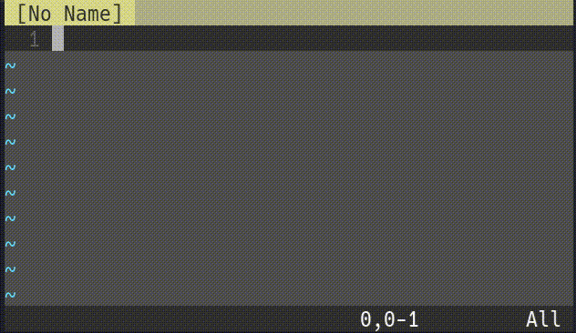
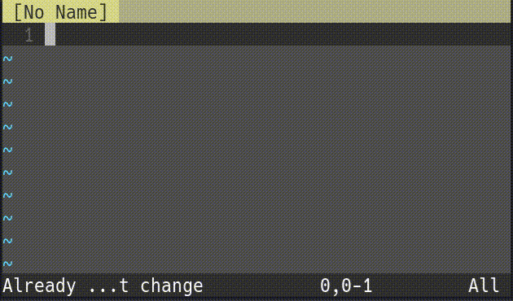
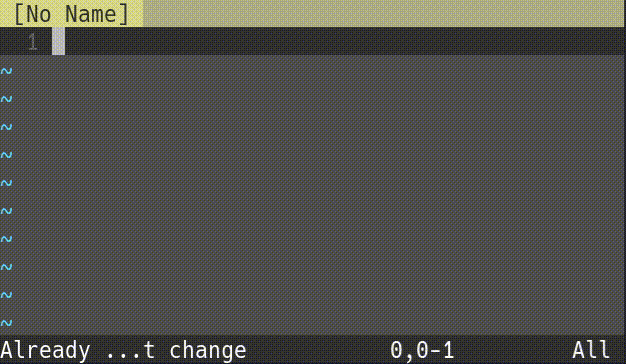
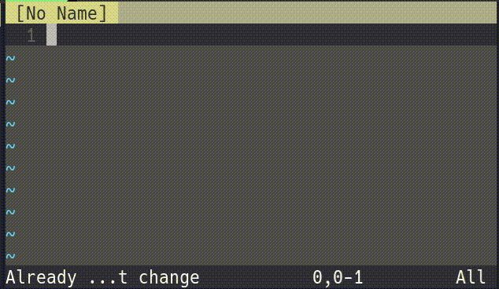

# Caskk

[](https://github.com/NI57721/vim-caskk/actions/workflows/ci.yml)

<!-- 英語READMEのリンクは英語版公開時に追加 -->

画面を見なくても思い通りに変換できるようなIMEが欲しい！  
これがCaskkの開発動機です🍺


Caskkは、Vim向けのSKK風日本語入力プラグインです。SKK辞書を使って変換します。動詞と形容詞の活用情報を利用した変換もオプションでサポートしています。また、AZIKユーザーに優しい設定方法も売りです。


## Demo
  


特定の単語を常に最上位に表示したり最下位に表示したりできます。
  


動詞や形容詞を「語幹 + 活用」で変換することもできます。
  


動詞や形容詞の登録も簡単に行えます。
  


## Prerequisite

CIでは`Vim 9.1.1826`と`HEAD`をテストしています。  
CaskkをインストールしてVimの`runtimepath`に追加したら、[設定例](#example)で始められます。


### Example

以下の例は、一般的なローマ字入力をベースにして、`<C-J>`でIMEをトグルするようにする設定です。

```vim
vim9script

import autoload 'caskk.vim' as Caskk

# ローマ字入力をベースに特殊な入力を定義
Caskk.RegisterInputScheme({
  base: 'roman',
  name: 'roman',
  specials: {
    'z-': '〜',
    'z=': '＝',
    'z ': '　',
    'z/': '・',
    'z[': '『',
    'z]': '』',
  }
})

Caskk.Config({
  dictionaries: [
    {path: '/path/to/SKK-JISYO.verb-adjective', encoding: 'utf-8'},
    {path: '/path/to/SKK-JISYO.L',              encoding: 'euc-jp'},
  ],
  state_path: expand('$XDG_STATE_HOME/caskk/state.jsonl'),
  candidate_select_keys: ['1', '2', '3', '4'],
  sticky_key: ';',
  affix_key: ';;',
  mappings: {
    "\<Space>": 'NextCandidate',
    "\<C-N>":   'NextCandidate',
    "\<C-P>":   'PreviousCandidate',
    "\<C-M>":   'Commit',
    '/':        'AbbreviationMode',
    "'":        'KatakanaMode',
    '#':        'HalfwidthKatakanaMode',
    '@':        'FullwidthAlphanumericMode',
    'p':        'TogglePin',
    'P':        'ToggleDemote',
    "\<C-H>":   'DeleteUserEntry',
    "\<Tab>":   'NextCompletion',
    "\<S-Tab>": 'PreviousCompletion',
    "\<C-E>":   'CancelCompletion',
  },
  highlight: {
    preedit: {
      term: 'reverse,bold', cterm: 'reverse,bold', gui: 'reverse,bold',
    }
  },
})

# IME のオン・オフをトグル
inoremap <silent> <C-J> <ScriptCmd>Caskk.Toggle('roman')<CR>
cnoremap <silent> <C-J> <ScriptCmd>Caskk.Toggle('roman')<CR>

# 再変換
nnoremap <Leader>r <ScriptCmd>Caskk.Reconvert()<CR>
```

<details>
<summary>Vim scriptでの設定例</summary>

```vim
" ローマ字入力をベースに特殊な入力を定義
call caskk#RegisterInputScheme(#{
      \   base: 'roman',
      \   name: 'roman',
      \   specials: {
      \     'z-': '〜',
      \     'z=': '＝',
      \     'z ': '　',
      \     'z/': '・',
      \     'z[': '『',
      \     'z]': '』',
      \   }
      \ })

call caskk#Config(#{
      \   dictionaries: [
      \     #{path: '/path/to/SKK-JISYO.verb-adjective', encoding: 'utf-8'},
      \     #{path: '/path/to/SKK-JISYO.L',              encoding: 'euc-jp'},
      \   ],
      \   state_path: expand('$XDG_STATE_HOME/caskk/state.jsonl'),
      \   candidate_select_keys: ['1', '2', '3', '4'],
      \   sticky_key: ';',
      \   affix_key: ';;',
      \   mappings: {
      \     "\<Space>": 'NextCandidate',
      \     "\<C-N>":   'NextCandidate',
      \     "\<C-P>":   'PreviousCandidate',
      \     "\<C-M>":   'Commit',
      \     '/':        'AbbreviationMode',
      \     "'":        'KatakanaMode',
      \     '#':        'HalfwidthKatakanaMode',
      \     '@':        'FullwidthAlphanumericMode',
      \     'p':        'TogglePin',
      \     'P':        'ToggleDemote',
      \     "\<C-H>":   'DeleteUserEntry',
      \     "\<Tab>":   'NextCompletion',
      \     "\<S-Tab>": 'PreviousCompletion',
      \     "\<C-E>":   'CancelCompletion',
      \   },
      \   highlight: #{
      \     preedit: #{
      \       term: 'reverse,bold', cterm: 'reverse,bold', gui: 'reverse,bold',
      \     }
      \   },
      \ })

" IME のオン・オフをトグル
inoremap <silent> <C-J> <Cmd>call caskk#Toggle('roman')<CR>
cnoremap <silent> <C-J> <Cmd>call caskk#Toggle('roman')<CR>

" 再変換
nnoremap <Leader>r <Cmd>call caskk#Reconvert()<CR>
```
</details>


# Interface

## Hooks

Caskk用のautocommandsを提供しています。  
次のように呼び出すことができます。  
`autocmd User CaskkPreeditStart echo "Preedit started"`


### `CaskkEnable`

対象バッファでCaskkが有効になったときに実行されます。


### `CaskkDisable`

対象バッファでCaskkが無効になったときに実行されます。


### `CaskkInputModeChanged`

ひらがな・カタカナなどの入力モードが変わったときに実行されます。


### `CaskkPreeditStart`

変換するための入力を開始したときに実行されます。


### `CaskkPreeditEnd`

変換を完了したときか、変換を中止したときに実行されます。


### `CaskkConversionStart`

最初の変換候補をプレビューしたときに実行されます。


### `CaskkConversionEnd`

確定・取消・候補切れで変換候補の選択を終えたときに実行されます。


### `CaskkCompletionStart`

通常補完の候補一覧が開いたときに実行されます。


### `CaskkCompletionEnd`

通常補完の候補一覧が閉じたときに実行されます。


### `CaskkRegistrationStart`

辞書登録欄が開いたときに実行されます。


### `CaskkRegistrationEnd`

辞書登録を完了するか取り消して、結果が元の位置に反映されたときに実行されます。


## APIs

Caskkでの入力や再変換用のAPIを提供しています。  
Vim scriptでは以下のように呼び出します。

```vim
call caskk#Enable('roman')
```

Vim9 scriptでは以下のように呼び出します。

```vim
vim9script
import autoload 'caskk.vim' as Caskk

Caskk.Enable('roman')
```

### `Caskk.Config(options)`

動作を設定し、システム辞書を読み込みます。  
詳細は[Configuration](#configuration)をご参照ください。


### `Caskk.RegisterInputScheme(definition)`

名前付きの変換テーブルを登録・更新します。  
詳細は[変換テーブルの定義](#caskkregisterinputschemedefinition)をご参照ください。


### `Caskk.Enable(name)`

現在のバッファ、または対象のコマンドラインでCaskkでの入力を有効にします。


### `Caskk.Disable()`

Caskkでの入力を無効にし、元のマッピングを復元します。


### `Caskk.Toggle(name)`

Caskkでの入力の有効・無効を切り替えます。


### `Caskk.IsEnabled()` → `bool`

Caskkでの入力が有効かどうかを返します。


### `Caskk.Reconvert()` → `bool`

ノーマルモードで、カーソル位置に重なる直近に変換した単語を再変換します。再変換が始まると`true`を返します。


### `Caskk.LoadState()`

`state_path`からユーザーが登録した単語と学習した内容、および変換の順位に関する情報を読み込みます。


### `Caskk.SaveState()`

現在のユーザー状態を`state_path`へ保存します。


### `Caskk.ExportUserDictionary(path)`

ユーザーが登録した単語をUTF-8のSKK辞書に書き出します。


### `Caskk.GetInputScheme(name)` → `CompiledScheme`

登録済みの入力方式のコンパイル結果を取得します。


### `Caskk.GetDictionaryLoadStatus()` → `dict<string>`

辞書の読み込み状態`loading`・`ready`・`error`とエラー詳細を返します。


### `Caskk.OpenRegistration()`

変換保留中の単語に対して、辞書登録UIを開きます。


### `Caskk.CompleteRegistration(text [, annotations])`

本文と任意で注釈を受け取り、辞書登録を完了します。


### `Caskk.CancelRegistration()`

変換保留中の単語の登録を取り消します。


### `Caskk.GetRegistrationRequest()` → `Requestまたはnull_object`

変換保留中の単語の情報を取得します。


## Configuration

`Caskk.Config(options)`は、以下の項目名をキーにした辞書を1つ受け取ります。例えば`Caskk.Config({sticky_key: ";", mode_popup: false})`のように指定します。呼び出すたびに、省略したキーは既定値に戻ります。  
全キーが省略可能です。型を示す以下の擬似コードでは、`?`が省略可能なキーを表します。

```text
options: {
  sticky_key?: string,
  affix_key?: string,
  keyboard_layout?: 'US' | 'JIS',
  keyboard_layout_overrides?: dict<string>,
  mappings?: dict<string>,
  dictionaries?: list<{path: string, encoding: string}>,
  state_path?: string,
  small_tsu_okuri_as_t?: bool,
  prefer_direct_okuri_nashi_learning?: bool,
  keep_preedit_on_backspace?: bool,
  undo_revert_to_reading?: bool,
  persist_input_mode?: bool,
  registration_auto?: bool,
  registration_prefill?: bool,
  registration_inline?: bool,
  register_mode_conversions?: bool,
  completion_min_length?: number,
  candidate_popup?: bool,
  candidate_select_keys?: list<string>,
  mode_popup?: bool,
  mode_popup_labels?: dict<string>,
  mode_popup_markers?: dict<string>,
  mode_popup_time?: number,
  highlight?: {preedit?: dict<string>},
}
```

### `sticky_key`

型: 文字列, 既定値: `''`  
このキーを指定すると、このキーの次に入力するキーがSKKでの大文字相当のキーとして入力されます。


### `affix_key`

型: 文字列, 既定値: `''`  
接頭辞・接尾辞の検索用に`>`を入力するキーを指定します。  
例えば、`{sticky_key: ';', affix_key: ';;'}`を指定すると、`;;てき`で「>てき」に相当する変換が、`;hi;;`で「ひ>」に相当する変換ができます。


### `keyboard_layout`

型: 文字列, 既定値: `'US'`  
キーボードの配列を指定します。`US`または`JIS`のみ有効です。


### `keyboard_layout_overrides`

型: 辞書, 既定値: `{}`  
Shift前後の記号の対応を個別に指定します。  
例えば`keyboard_layout_overrides: {'1': '?'}`は、`Shift-1`が`?`であるとして設定します。`1`に子音の`k`を割り当てていた場合、`?a`で`Ka`に相当する入力ができるようになります。


### `mappings`

型: 辞書, 既定値: `{}`  
モードの切り替えや変換中の操作にキーを割り当てます。詳細は[Mapping Actions](#mapping-actions)をご参照ください。


### `dictionaries`

型: リスト, 既定値: `[]`  
SKK辞書を優先順に指定します。各項目には`path`と`encoding`が必要です。

```vim
dictionaries: [
  {path: '/path/to/SKK-JISYO.utf8', encoding: 'utf-8'},
  {path: '/path/to/SKK-JISYO.L',    encoding: 'euc-jp'},
],
```


### `state_path`

型: 文字列, 既定値: `''`  
ユーザー状態の保存先です。指定すると初回の有効化時に読み込み、状態の変更時とVim終了時に自動保存します。空文字列なら状態をメモリ内だけに保持します。


### `small_tsu_okuri_as_t`

型: 真偽値, 既定値: `true`  
「っ」で始まる送り仮名の子音をtで決め打ちます。「おも*っ」などで変換するとこの後にタ行が続くものとして変換候補を探します。


### `prefer_direct_okuri_nashi_learning`

型: 真偽値, 既定値: `true`  
送り仮名の無い単語の履歴を、語幹を共有する学習よりも優先します。  
例えば、「いえ」で「家」と変換した後に「いえ*る」で「癒える」と変換した場合、次に「いえ」を変換すると「癒え」より先に「家」が候補に出ます。この後更に「いえ」で「癒え」と変換すると今度は「癒え」が先に出ます。


### `keep_preedit_on_backspace`

型: 真偽値, 既定値: `true`  
変換中の読みを削除していき全ての文字が消えたときでも変換状態を維持します。


### `undo_revert_to_reading`

型: 真偽値, 既定値: `true`  
undoをするときに、変換された文字列を変換前の状態に戻すステップを含めるようにします。


### `persist_input_mode`

型: 真偽値, 既定値: `false`  
同じバッファで挿入モードを出入りしても入力モードを維持します。


### `registration_auto`

型: 真偽値, 既定値: `true`  
変換候補が尽きたときに辞書登録UIを自動で開きます。


### `registration_prefill`

型: 真偽値, 既定値: `true`  
辞書登録UIについて、登録する単語の読みが既に入力されている状態で起動します。


### `registration_inline`

型: 真偽値, 既定値: `true`  
辞書登録UIについて、コマンドラインの代わりにポップアップを使います。


### `register_mode_conversions`

型: 真偽値, 既定値: `true`  
カタカナ・全角英数へのモード変換結果をユーザー辞書に登録します。


### `completion_min_length`

型: 正の整数, 既定値: `2`  
補完を始める最小文字数を指定します。


### `candidate_popup`

型: 真偽値, 既定値: `true`  
変換候補をポップアップで表示します。


### `candidate_select_keys`

型: リスト, 既定値: `[]`  
変換候補を選択するラベルキーを指定します。  
既定値だと候補を1個ずつ上下して選択します。  
`['1', '2', '3']`と指定すると一度に3個ずつ表示され`1`, `2`, `3`で候補を選択します。


### `mode_popup`

型: 真偽値, 既定値: `true`  
カーソル付近に入力モードに合わせたポップアップを表示します。


### `mode_popup_labels`

型: 辞書, 既定値: `{hiragana: 'あ', abbreviation: 'ab', katakana: 'ア', halfwidth_katakana: 'ｱ', fullwidth_alphanumeric: 'Ａ'}`  
入力モードに合わせたポップアップの表示名を指定します。


### `mode_popup_markers`

型: 辞書, 既定値: `{modified: '▽', candidate: '▼'}`  
入力モードに合わせたポップアップについて、変換中・変換候補の選択中を表すマーカーを指定します。


### `mode_popup_time`

型: 0以上の整数, 既定値: `0`  
入力モードに合わせたポップアップについて、自動で消えるまで時間をミリ秒で指定します。`0`はカーソル移動や入力終了まで表示します。


### `highlight`（`preedit`）

型: 辞書, 既定値: `{preedit: {term: 'underline', cterm: 'underline', gui: 'underline'}}`  
変換中の文字列に適用されるハイライトを指定します。


## Mapping Actions

`mappings`にはキーと操作名の対応を指定します。例えば`mappings: {"\<Space>": "NextCandidate"}`でSpaceに変換開始と候補送りを割り当てます。特殊キーの指定には`"\<Space>"`のようなVimのキーコードの入力方法をそのまま使います。操作名は以下の通りです。


### `NextCandidate`

変換を開始するか、次の候補に進みます。


### `PreviousCandidate`

前の候補に戻ります。最初の候補からさらに戻ると読みの編集に戻ります。


### `Commit`

変換を確定します。


### `NextCompletion`

補完用のポップアップを開いて最初の候補を選ぶか、次の補完候補に進みます。


### `PreviousCompletion`

読み補完で前の候補に戻ります。先頭から戻ると未選択になり、未選択から戻ると末尾の候補に移動します。


### `CancelCompletion`

補完を閉じて読みの編集に戻ります。


### `OpenRegistration`

保留中の単語に対して辞書登録UIを開きます。


### `TogglePin`

選択中の変換候補を常に一番上に表示させます。またはそのように表示されている変換候補の設定を取り消します。  
1つの読みに対して1つだけ指定することができます。


### `ToggleDemote`

選択中の変換候補を常に一番下に表示させます。またはそのように表示されている変換候補の設定を取り消します。  
1つの読みに対して複数指定することができます。


### `DeleteUserEntry`

選択中のユーザー登録単語について、削除用UIを開きます。


### `AbbreviationMode`

英数字などの入力をそのまま辞書検索の読みにするモードに切り替えます。


### `KatakanaMode`

全角カタカナの入力モードに切り替えます。


### `HalfwidthKatakanaMode`

半角カタカナの入力モードに切り替えます。


### `FullwidthAlphanumericMode`

全角英数字の入力モードに切り替えます。


## Conversion Table

変換テーブルを定義します。デフォルトでは一般的なローマ字入力である`roman`と[AZIK考案者の原案](http://www1.vecceed.ne.jp/~bemu/azik/azikinfo.htm)に準拠した`azik`とがあります。

<details>
<summary>romanの定義</summary>

設定として書き下すと以下のようになります。

```vim
vim9script

import autoload 'caskk.vim' as Caskk

Caskk.RegisterInputScheme({
  name: 'my-roman',
  consonants: {
    k: 'k', g: 'g', s: 's', z: 'z', t: 't', d: 'd', n: 'n', h: 'h',
    b: 'b', p: 'p', m: 'm', y: 'y', r: 'r', w: 'w', f: 'f', v: 'v',
    j: 'zy', c: 'k', x: 'x', l: 'x',
    ky: 'ky', gy: 'gy', sy: 'sy', zy: 'zy', ty: 'ty', dy: 'dy', ny: 'ny',
    hy: 'hy', by: 'by', py: 'py', my: 'my', ry: 'ry',
    sh: 'sy', ch: 'ty', cy: 'ty', jy: 'zy', fy: 'fy',
    wh: 'wh', xy: 'xy', xw: 'xw', ly: 'xy', lw: 'xw', ts: 'ts', th: 'th', dh: 'dh',
    bb: 'Tb', cc: 'Tk', dd: 'Td', ff: 'Tf', gg: 'Tg', hh: 'Th', jj: 'Tzy',
    kk: 'Tk', ll: 'Tx', mm: 'Tm', pp: 'Tp', rr: 'Tr', ss: 'Ts', tt: 'Tt',
    vv: 'Tv', ww: 'Tw', xx: 'Tx', yy: 'Ty', zz: 'Tz',
  },
  combinations: {a: 'a', i: 'i', u: 'u', e: 'e', o: 'o'},
  specials: {
    nn: 'ん', "n'": 'ん',
    xtu: 'っ', xtsu: 'っ', ltu: 'っ', ltsu: 'っ',
    '!': '！', ',': '、', '-': 'ー', '.': '。', ':': '：', ';': '；', '?': '？', '[': '「', ']': '」',
  },
})
```
</details>

<details>
<summary>azikの定義</summary>

```vim
vim9script

import autoload 'caskk.vim' as Caskk

Caskk.RegisterInputScheme({
  name: 'my-azik',
  consonants: {
    k: 'k', s: 's', t: 't', n: 'n', h: 'h', f: 'f',
    m: 'm', y: 'y', r: 'r', w: 'w', g: 'g', z: 'z',
    d: 'd', b: 'b', p: 'p', v: 'v',
    ky: 'ky', kg: 'ky', sy: 'sy', x: 'sy', ty: 'ty', c: 'ty',
    ny: 'ny', ng: 'ny', hy: 'hy', hg: 'hy', my: 'my', mg: 'my',
    ry: 'ry', gy: 'gy', zy: 'zy', j: 'zy', by: 'by', py: 'py', pg: 'py',
    tg: 'th', dc: 'dh', ws: 'wh',
    l: 'x', ly: 'xy', lw: 'xw', q: 'N', ';': 'T',
  },
  combinations: {
    a: 'a', i: 'i', u: 'u', e: 'e', o: 'o',
    z: 'a*N', n: 'a*N', k: 'i*N', j: 'u*N', d: 'e*N', l: 'o*N',
    q: 'a*i', h: 'u*u', w: 'e*i', p: 'o*u',
  },
  specials: {
    '-': 'ー', ':': 'ー', nn: 'ん',
    tgu: 'とぅ', tgj: 'とぅ*ん', tgh: 'とぅ*う',
    dcu: 'どぅ', dcj: 'どぅ*ん', dch: 'どぅ*う',
    wp: 'うぉー', wl: 'うぉ*ん', fp: 'ふぉー',
    kf: 'き', jf: 'じゅ', hf: 'ふ', yf: 'ゆ', mf: 'む',
    nf: 'ぬ', df: 'で', cf: 'ちぇ', pf: 'ぽん',
    wf: 'わい', sf: 'さい', ss: 'せい',
    zc: 'ざ', zv: 'ざい', zf: 'ぜ', zx: 'ぜい',
    kt: 'こと', st: 'した', tt: 'たち', ht: 'ひと',
    wt: 'わた', mn: 'もの', ms: 'ます', ds: 'です',
    km: 'かも', tm: 'ため', dm: 'でも', kr: 'から',
    sr: 'する', tr: 'たら', nr: 'なる', yr: 'よる',
    rr: 'られ', zr: 'ざる', mt: 'また', tb: 'たび',
    nb: 'ねば', bt: 'びと', gr: 'がら', gt: 'ごと',
    nt: 'にち', dt: 'だち', wr: 'われ',
  },
})
```
</details>


### Caskk.RegisterInputScheme(definition)

`Caskk.RegisterInputScheme(definition)`は入力方式を定義する辞書を1つ受け取ります。独自の方式を定義するには`name`、`consonants`、`combinations`を指定します。組み込みの方式を継承する場合は`name`と`base`を指定し、変更する項目だけを追加できます。  
型を示すための擬似コードです。`?`は省略可能なキーを表します。`base`を省略する場合は`consonants`と`combinations`が必須です。

```text
definition: {
  name: string,
  base?: string,
  consonants?: dict<string | null>,
  combinations?: dict<string | null>,
  specials?: dict<string | null>,
  n_fallback?: bool,
}
```

値の`v:null`は、継承元の規則を削除するときに指定できます。

#### `name`

入力方式の名前を文字列で指定します。`Enable()`や`Toggle()`でこの名前を使います。


#### `base`

`'roman'`または`'azik'`を指定すると、組み込みの定義を継承します。`consonants`、`combinations`、`specials`の規則はキー単位で上書きすることができます。  
全ての配列を自身で定義する場合は設定不要です。


#### `consonants`

入力するキーの列と子音との対応を辞書で指定します。例えば`sh: 'sy'`とすると`sha`で「しゃ」と入力できます。子音という項目ですが、例外的に「ん」と「っ」も設定できます。詳しくは[子音識別子と母音の対応表](#kanatable)をご参照ください。  
1つのキーの列には通常1つの子音識別子を指定しますが、「っ」を子音の前に付けて指定することもできます。例えば`kk: 'Tk'`とすると`kka`で「っか」と入力できます。


#### `combinations`

`consonants`で定義された子音に続く母音などを定義します。`s: 'a'`とすると`ks`で「か」と入力できます。母音から始まりさえすれば、長い組み合わせを指定することもできます。詳しくは[子音識別子と母音の対応表](#kanatable)をご参照ください。  
`*`を使うと、潜在的な送り仮名の位置を指定することができます。例えば`p: 'a*imasu'`とすると`kp`で「かいます」と入力できますが、`KP`または`;k;p`などとすると「か*います」という変換が始まります。


#### `specials`

入力するキーの列と文字列の対応を辞書で指定します。例えば`nn: 'ん'`とすると`nn`で「ん」と入力できます。`consonants`と`combinations`の組み合わせよりも優先して照合されます。

出力に`*`を書くと潜在的な送り仮名の位置を指定できます。例えば`mm: 'あ*う'`とすると、`Mm`で「あう」、`MM`で「あ*う」、`DakiMm`で「だき*あう」、`DakimM`で「だきあ*う」などのように変換が始まります。

文字として`*`を出すには`\*`、バックスラッシュを出すには`\\`と書きます。


#### `n_fallback`

既定は`true`です。単独の`n`を子音の前や確定時に「ん」として扱うかを真偽値で指定します。


#### Kana Table

<details>
<summary>子音識別子と母音の組み合わせ</summary>

| 識別子 | a | i | u | e | o |
| --- | --- | --- | --- | --- | --- |
| （子音なし） | あ | い | う | え | お |
| N（単独で「ん」） | — | — | — | — | — |
| T（単独で「っ」） | — | — | — | — | — |
| x | ぁ | ぃ | ぅ | ぇ | ぉ |
| xy | ゃ | ぃ | ゅ | ぇ | ょ |
| xw | ゎ | ゐ | ぅ | ゑ | ぉ |
| k | か | き | く | け | こ |
| g | が | ぎ | ぐ | げ | ご |
| s | さ | し | す | せ | そ |
| z | ざ | じ | ず | ぜ | ぞ |
| t | た | ち | つ | て | と |
| d | だ | ぢ | づ | で | ど |
| n | な | に | ぬ | ね | の |
| h | は | ひ | ふ | へ | ほ |
| b | ば | び | ぶ | べ | ぼ |
| p | ぱ | ぴ | ぷ | ぺ | ぽ |
| m | ま | み | む | め | も |
| y | や | い | ゆ | いぇ | よ |
| r | ら | り | る | れ | ろ |
| w | わ | うぃ | う | うぇ | を |
| ky | きゃ | き | きゅ | きぇ | きょ |
| gy | ぎゃ | ぎ | ぎゅ | ぎぇ | ぎょ |
| sy | しゃ | し | しゅ | しぇ | しょ |
| zy | じゃ | じ | じゅ | じぇ | じょ |
| ty | ちゃ | ち | ちゅ | ちぇ | ちょ |
| dy | ぢゃ | ぢ | ぢゅ | ぢぇ | ぢょ |
| ny | にゃ | に | にゅ | にぇ | にょ |
| hy | ひゃ | ひ | ひゅ | ひぇ | ひょ |
| by | びゃ | び | びゅ | びぇ | びょ |
| py | ぴゃ | ぴ | ぴゅ | ぴぇ | ぴょ |
| my | みゃ | み | みゅ | みぇ | みょ |
| ry | りゃ | り | りゅ | りぇ | りょ |
| ts | つぁ | つぃ | つ | つぇ | つぉ |
| th | てゃ | てぃ | てゅ | てぇ | てょ |
| dh | でゃ | でぃ | でゅ | でぇ | でょ |
| wh | うぁ | うぃ | う | うぇ | うぉ |
| f | ふぁ | ふぃ | ふ | ふぇ | ふぉ |
| fy | ふゃ | ふぃ | ふゅ | ふぇ | ふょ |
| v | ゔぁ | ゔぃ | ゔ | ゔぇ | ゔぉ |
</details>


## Conjugation


形容詞と動詞について、活用タグを付けて単語を登録すると、同じ単語を複数の送り仮名で変換できるようになります。例えば辞書に`おも /思;@verb-5-w/`があれば、`おも*う`は「思う」、`おも*わない`は「思わない」になります。形容詞なら`うつくし /美し;@adj/`で「美しく」「美しか」などが変換できます。「うつくし*べ」など無効な送り仮名では変換できません。


活用タグを付けて登録するには補完機能を使うと便利です。

`おも*う`から登録する場合は、単語登録欄の本文を`思`にしてタブを押します。すると、`思;@`という状態で活用タグの補完が表示されるのでタブで選択します。補完中に活用タグの一部を直接入力して補完候補を更に絞り込むこともできます。


活用タグ付きの動詞・形容詞を収録したUTF-8のSKK辞書も公開しています。[skk-verb-adjective-dictionary](https://github.com/NI57721/skk-verb-adjective-dictionary)

<details>
<summary>活用タグ全58種</summary>


| タグ | 活用の種類 |
| --- | --- |
| `@adj` | 形容詞 |
| `@verb-5-k` | カ行五段活用 |
| `@verb-5-k-iku` | カ行五段活用（行く） |
| `@verb-5-k-yuku` | カ行五段活用（往く） |
| `@verb-5-g` | ガ行五段活用 |
| `@verb-5-s` | サ行五段活用 |
| `@verb-5-t` | タ行五段活用 |
| `@verb-5-n` | ナ行五段活用 |
| `@verb-5-b` | バ行五段活用 |
| `@verb-5-m` | マ行五段活用 |
| `@verb-5-r` | ラ行五段活用 |
| `@verb-5-r-aru` | ラ行五段活用（ある） |
| `@verb-5-w` | ワ行五段活用 |
| `@verb-5-w-tou` | ワ行五段活用（問う） |
| `@verb-1` | 一段活用 |
| `@verb-1-uru` | 一段活用（得る） |
| `@verb-1-kureru` | 一段活用（呉れる） |
| `@verb-henkaku-k` | カ行変格活用 |
| `@verb-henkaku-s` | サ行変格活用 |
| `@verb-henkaku-z` | ザ行変格活用 |
| `@verb-bungo-4-k` | 文語カ行四段活用 |
| `@verb-bungo-4-g` | 文語ガ行四段活用 |
| `@verb-bungo-4-s` | 文語サ行四段活用 |
| `@verb-bungo-4-t` | 文語タ行四段活用 |
| `@verb-bungo-4-h-u` | 文語ハ行四段活用（う） |
| `@verb-bungo-4-h-hu` | 文語ハ行四段活用（ふ） |
| `@verb-bungo-4-b` | 文語バ行四段活用 |
| `@verb-bungo-4-m` | 文語マ行四段活用 |
| `@verb-bungo-4-r` | 文語ラ行四段活用 |
| `@verb-bungo-2-kami-k` | 文語カ行上二段活用 |
| `@verb-bungo-2-kami-g` | 文語ガ行上二段活用 |
| `@verb-bungo-2-kami-t` | 文語タ行上二段活用 |
| `@verb-bungo-2-kami-d` | 文語ダ行上二段活用 |
| `@verb-bungo-2-kami-h` | 文語ハ行上二段活用 |
| `@verb-bungo-2-kami-b` | 文語バ行上二段活用 |
| `@verb-bungo-2-kami-m` | 文語マ行上二段活用 |
| `@verb-bungo-2-kami-y` | 文語ヤ行上二段活用 |
| `@verb-bungo-2-kami-r` | 文語ラ行上二段活用 |
| `@verb-bungo-2-shimo-a` | 文語ア行下二段活用 |
| `@verb-bungo-2-shimo-k` | 文語カ行下二段活用 |
| `@verb-bungo-2-shimo-g` | 文語ガ行下二段活用 |
| `@verb-bungo-2-shimo-s` | 文語サ行下二段活用 |
| `@verb-bungo-2-shimo-z` | 文語ザ行下二段活用 |
| `@verb-bungo-2-shimo-t` | 文語タ行下二段活用 |
| `@verb-bungo-2-shimo-d-zu` | 文語ダ行下二段活用（ず） |
| `@verb-bungo-2-shimo-d-du` | 文語ダ行下二段活用（づ） |
| `@verb-bungo-2-shimo-n` | 文語ナ行下二段活用 |
| `@verb-bungo-2-shimo-h` | 文語ハ行下二段活用 |
| `@verb-bungo-2-shimo-b` | 文語バ行下二段活用 |
| `@verb-bungo-2-shimo-m` | 文語マ行下二段活用 |
| `@verb-bungo-2-shimo-y` | 文語ヤ行下二段活用 |
| `@verb-bungo-2-shimo-r` | 文語ラ行下二段活用 |
| `@verb-bungo-2-shimo-w` | 文語ワ行下二段活用 |
| `@verb-bungo-henkaku-k` | 文語カ行変格活用 |
| `@verb-bungo-henkaku-s` | 文語サ行変格活用 |
| `@verb-bungo-henkaku-z` | 文語ザ行変格活用 |
| `@verb-bungo-henkaku-n` | 文語ナ行変格活用 |
| `@verb-bungo-henkaku-r` | 文語ラ行変格活用 |
</details>


## Licence

[MITライセンス](LICENSE)


## Acknowledgments

SKKの入力と変換の仕組みを受け継いできた[ddskk](https://github.com/skk-dev/ddskk)の開発者の皆さんに感謝します。

UIを設計する際には、[skkeleton](https://github.com/vim-skk/skkeleton)を参考にしました。この場を借りてお礼申し上げます。
